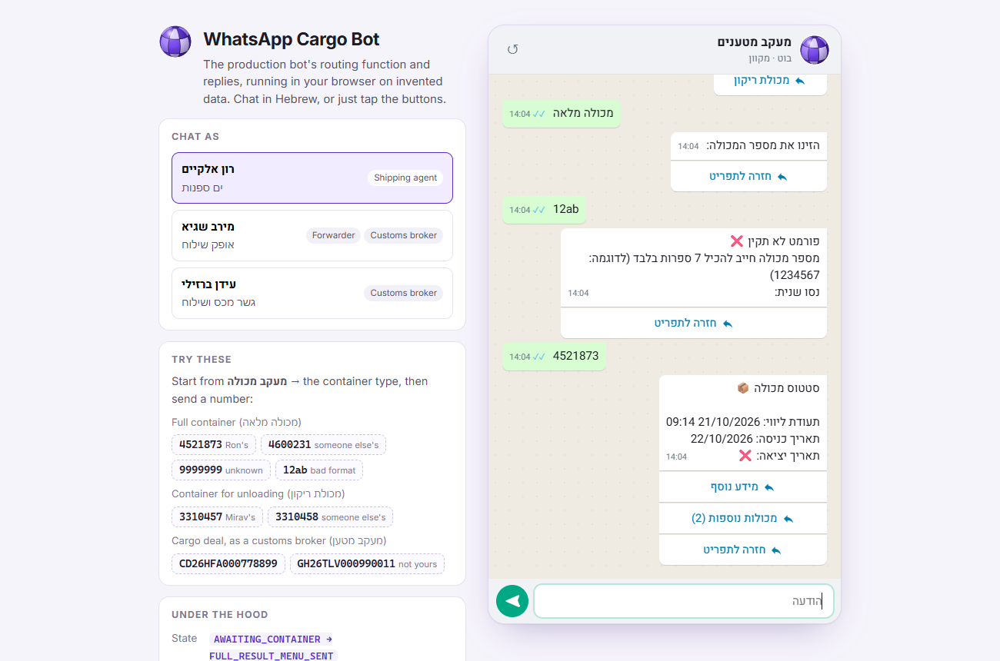
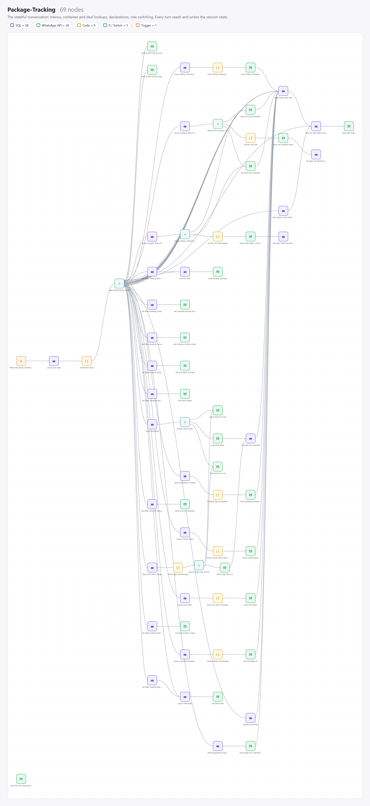
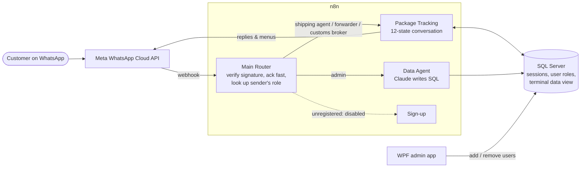
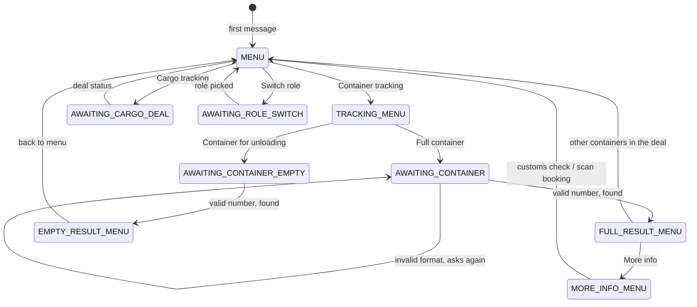
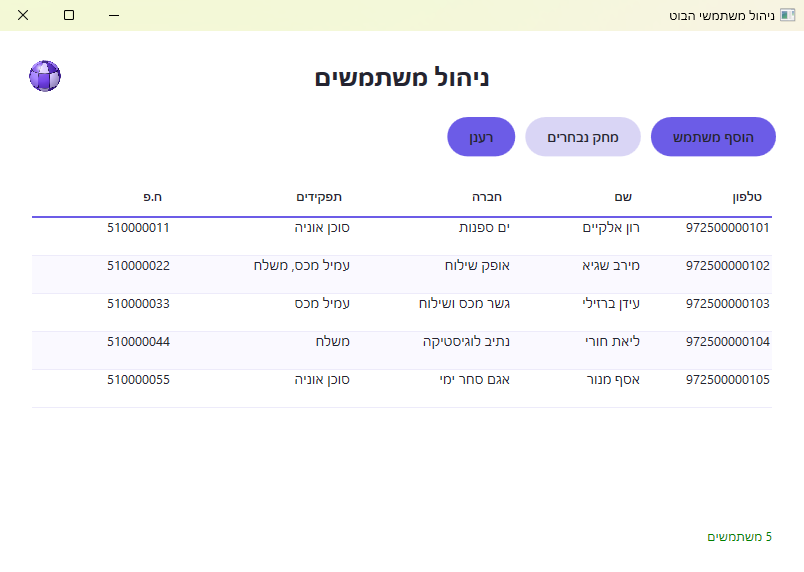

# WhatsApp Cargo Bot: container and shipment tracking over WhatsApp

A WhatsApp bot that lets a terminal's business customers (shipping agents, forwarders and customs
brokers) check their containers, deals and customs declarations by chatting, instead of calling
customer service. Built in **n8n** on the **WhatsApp Cloud API**, backed by SQL Server, with a
small **WPF admin app** for managing who may use it and an **AI data agent** (Claude) for
free-form questions.

**Deployed on the company's WhatsApp Business number, in a closed pilot.** This repository is a case study: the workflows are exported with every
identifier, number and credential removed, and the company's database schema renamed to generic
names.

**[Try the bot →](https://MrCuteFace.github.io/whatsapp-bot/)** A chat simulator running the
production routing function and replies in your browser, on invented data. Pick a user, tap the
menus, type container numbers, and watch which workflow nodes would run for each message
([source](site/)).

| | |
|---|---|
| **Workflows** | 4, with **124 nodes** in total |
| **Conversation states** | 12, with 36 routes between them |
| **SQL queries** | 42 |
| **WhatsApp API calls** | 38 distinct messages and menus |

## How a message flows

**Main Router** ([workflow](workflows/main-router.json), [canvas](docs/canvas-main-router.png)):
- Answers Meta's subscription handshake.
- Verifies every POST against Meta's `X-Hub-Signature-256` HMAC with a timing-safe compare.
- Acknowledges immediately, so Meta never retries a slow conversation turn.
- Ignores delivery-status callbacks.
- Works around a WhatsApp Web bug with interactive replies.
- Routes by the sender's role. Two test phones are routed to the development copies of the sub-workflows, so changes can be tried on the production number without affecting customers.

## The conversation

Each phone number has one row in a `sessions` table holding its current state, plus the last
container and deal it asked about. Every incoming message is one turn:

1. Read the state.
2. A single routing function picks the route from state + message, using the button IDs for taps
   and a format check for typed IDs.
3. One branch runs: query, reply, write the next state.

Every waiting state also accepts "back to menu", and anything unexpected re-sends the current menu
rather than failing. The routing table still holds three earlier branches (declaration lookup, a
deal inside an unloading container, its package list) whose buttons the menus no longer offer. Two details customers notice:

- **Re-check the last one.** The last container and deal are kept on the session, so "check again"
  is one tap instead of retyping the number.
- **Ownership checks per lookup.** Container status is shared freely, but deals, packages and
  declarations are only shown to the company they belong to. A match owned by someone else returns
  a polite "not yours", which is not the same as "not found".

**Users with several roles** (a forwarder that is also a customs broker) have one active role at a
time and switch from the main menu. Each role sees its own slice of the data.

## The data agent

Admins can ask questions in plain Hebrew or English ("which of our containers left this week?").
Claude (Haiku 4.5) answers by writing SQL against a single deals table, through n8n's agent node
with a SQL tool ([workflow](workflows/data-agent.json)).

The prompt tells the model to always filter by the asking company's ID and to run SELECT only.
**That prompt is not a security boundary**: a model can be talked out of an instruction. The
route is admin-only for that reason. Before opening it to customers, the boundary has to move into
the database: a read-only login that can only see a view already filtered to the company.

## The admin app

Self-serve sign-up exists ([workflow](workflows/sign-up.json): name, role, company ID checked
against the customer table). It is switched off in favour of an admin approving each number.
That is done in a small WPF app ([source](admin-app/)): list users with their company and roles,
add a user with one or more roles, remove users. It looks the company up by ID and uses
parameterized queries throughout.

## What I'd point out in review

- **SQL from chat input.** n8n's SQL node runs a query built by expression interpolation, so any
  typed text that reaches a query is a risk. In this export, the two steps that accept free text
  (deal number, declaration number) are reduced to plain IDs before any lookup, and every
  interpolated value has its quotes escaped. Fixed-choice steps rely on button IDs instead of typed
  text.
- **Old buttons never expire.** WhatsApp lets people tap reply buttons on messages from weeks ago.
  Removing a button from the menus therefore does not remove the route behind it: anyone who
  received the old message can still trigger it whenever their session is in the matching state.
  Retired branches have to be deleted, or guarded as carefully as live ones.
- **Secrets stay out of code.** Workflows reference n8n credentials by name. The admin app reads
  its connection string from the environment, because a string compiled into a ClickOnce app
  ships to every machine that installs it.
- **One routing function, many small branches.** All conversation logic is a single readable table
  of `state + input -> route`. That is what kept 70 nodes understandable.

## Repository

| Path | What |
|---|---|
| `site/` | The chat simulator: static HTML/JS, published to GitHub Pages. |
| `workflows/` | The four n8n workflows, importable. Replace the `REPLACE_WITH_…` credentials and sub-workflow IDs, and set `WHATSAPP_PHONE_NUMBER_ID` and `META_APP_SECRET` in n8n's environment. |
| `admin-app/` | WPF (.NET) admin app. Set `BOT_DB_CONNECTION` before running. |
| `docs/` | Workflow canvases rendered from the JSON, and screenshots. |

Table and column names are generic stand-ins (`v_terminal_cargo`, `deal_number`, …), not the
production schema.
